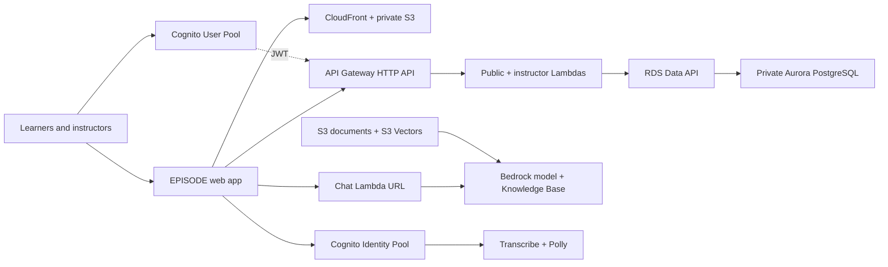
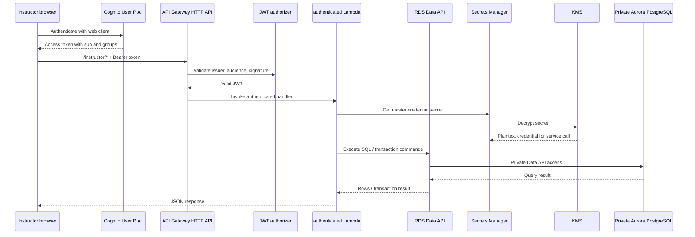
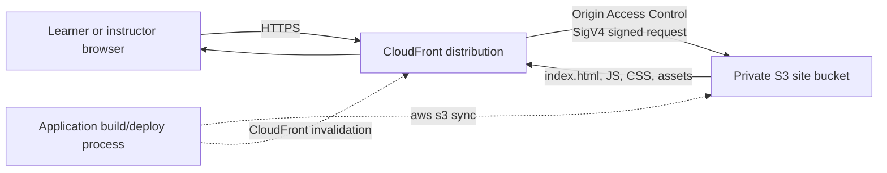
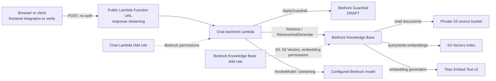
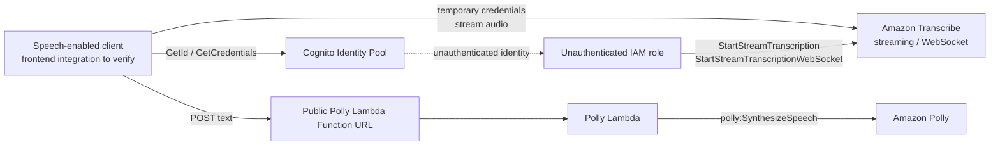

# EPISODE AWS Architecture

**Scope:** Terraform-defined current state for `ubc-eml-episode` in `ca-central-1`, using the active `prod` configuration.

**Configuration:** `enable_viewer_site = true` and `enable_episode_database = true`.

This document describes the architecture expressed by Terraform and the checked-in application code. It is not a replacement for comparing against HCP Terraform state or the AWS console. Resource comments that mention existing infrastructure are treated as migration history until verified.

## Compact Diagram

This is the deliberately abbreviated version for Mermaid editors with input limits:

**Reading the diagram:** the web app is delivered through CloudFront from a private S3 bucket. API Gateway sends public and instructor requests to separate Lambda handlers; those handlers use the RDS Data API to reach private Aurora. Cognito protects instructor routes. The chat endpoint invokes Bedrock, using documents and vector embeddings from S3. The speech path uses a Cognito Identity Pool with Transcribe and Polly.

## Overview

```mermaid
flowchart TB
    learner["Learner / instructor browser"]
    operator["Content operator"]
    speechClient["Speech-enabled client"]

    subgraph aws["AWS account - ca-central-1"]
        subgraph edge["Public delivery and API endpoints"]
            cf["CloudFront distribution\nviewer SPA"]
            siteOac["CloudFront Origin Access Control\nSigV4"]
            siteBucket["Private S3 site bucket\nindex.html and assets"]
            api["API Gateway HTTP API\n$default stage\n50 req/s, burst 100"]
            chatUrl["Lambda Function URL\npublic, response streaming"]
            pollyUrl["Lambda Function URL\npublic, buffered"]
            cognito["Cognito User Pool\nHosted UI + web client\ninstructor/admin groups"]
            identityPool["Cognito Identity Pool\nunauthenticated identities"]
        end

        subgraph apiPlane["EPISODE API compute"]
            publicFn["Lambda: public handler\nlogin, scenario links, attempts"]
            authFn["Lambda: authenticated handler\ninstructor scenarios and analytics"]
            chatFn["Lambda: chat backend"]
            pollyFn["Lambda: Polly backend"]
            apiLogs["CloudWatch log groups\npublic + authenticated"]
        end

        subgraph privateData["Private database data plane - VPC 10.42.0.0/16"]
            subgraph az1["ca-central-1a"]
                subnet1["Private subnet\n10.42.1.0/24"]
            end
            subgraph az2["ca-central-1b"]
                subnet2["Private subnet\n10.42.2.0/24"]
            end
            routes["Private route tables\nno IGW or NAT"]
            aurora["Aurora Serverless v2\nPostgreSQL / episode"]
            dbSg["Aurora security group"]
            secret["Secrets Manager\nRDS master credentials"]
            secretKey["Customer-managed KMS key\nsecret encryption"]
        end

        subgraph ai["Bedrock retrieval and generation"]
            sourceBucket["Private S3 source bucket\nknowledge-base documents"]
            kb["Bedrock Knowledge Base\nS3 data source"]
            vectors["S3 Vectors bucket + index\n1024-dimension embeddings"]
            embedding["Amazon Titan Embed Text v2"]
            guardrail["Bedrock Guardrail\nDRAFT version"]
            model["Configured Bedrock chat model"]
            kbRole["Bedrock KB IAM role\nS3 + S3 Vectors + embedding access"]
            chatRole["Chat Lambda IAM role\nmodel, Retrieve, guardrail access"]
        end

        subgraph speech["Speech services"]
            transcribeRole["Unauthenticated IAM role\nTranscribe streaming permissions"]
            transcribe["Amazon Transcribe\nstreaming / WebSocket"]
            polly["Amazon Polly"]
        end
    end

    learner -->|HTTPS static app| cf
    instructor["Instructor"] -->|HTTPS static app| cf
    cf --> siteOac
    siteOac -->|signed S3 read| siteBucket

    learner -->|public routes| api
    instructor -->|instructor routes + JWT| api
    instructor -->|sign in / reset| cognito
    cognito -.->|JWT issuer and client audience| api
    api -->|NONE routes| publicFn
    api -->|JWT routes| authFn
    publicFn -->|RDS Data API| aurora
    authFn -->|RDS Data API| aurora
    publicFn -->|GetSecretValue| secret
    authFn -->|GetSecretValue| secret
    publicFn -->|kms:Decrypt| secretKey
    authFn -->|kms:Decrypt| secretKey
    apiLogs -.->|execution logs| publicFn
    apiLogs -.->|execution logs| authFn

    learner -->|POST chat| chatUrl
    chatUrl --> chatFn
    chatFn -->|Retrieve / RetrieveAndGenerate| kb
    chatFn -->|ApplyGuardrail + model invoke| guardrail
    chatFn -->|InvokeModel streaming| model
    kb -->|read and ingest| sourceBucket
    kb -->|query and write vectors| vectors
    kb -->|create embeddings| embedding
    kbRole -.->|service access| kb
    chatRole -.->|execution permissions| chatFn

    speechClient -->|obtain unauthenticated identity| identityPool
    identityPool -.->|assume role| transcribeRole
    speechClient -->|stream audio with temporary credentials| transcribe
    transcribeRole -->|StartStreamTranscription| transcribe
    speechClient -->|POST speech text| pollyUrl
    pollyUrl --> pollyFn
    pollyFn -->|SynthesizeSpeech| polly

    subnet1 --- routes
    subnet2 --- routes
    aurora --- subnet1
    aurora --- subnet2
    dbSg -.->|attached to| aurora
    secret -.->|encrypted by| secretKey

    classDef actor fill:#fff4d6,stroke:#9a6b00,color:#332400
    classDef public fill:#e4f1ff,stroke:#2769a6,color:#102b45
    classDef compute fill:#e9f7ed,stroke:#3b7d4f,color:#17351f
    classDef data fill:#fff0e6,stroke:#b45f26,color:#48230e
    classDef ai fill:#f0eaff,stroke:#6e51a3,color:#2d2052
    classDef identity fill:#e8f5f2,stroke:#2d7a6b,color:#123d35

    class learner,instructor,operator,speechClient actor
    class cf,siteOac,siteBucket,api,chatUrl,pollyUrl,cognito,identityPool public
    class publicFn,authFn,chatFn,pollyFn,apiLogs compute
    class subnet1,subnet2,routes,aurora,dbSg,secret,secretKey data
    class sourceBucket,kb,vectors,embedding,guardrail,model,kbRole,chatRole ai
    class transcribeRole,transcribe,polly identity
```

## Runtime Flows

### API, authentication, and database

Public routes bypass the JWT authorizer and invoke `public.handler`:

- `POST /auth/login`
- `POST /auth/forgot-password`
- `POST /auth/confirm-password`
- `GET /scenarios/{slug}`
- `POST /attempts`

Instructor routes invoke `authenticated.handler` after JWT validation:

- `GET|POST /instructor/scenarios`
- `PATCH /instructor/scenarios/{id}`
- `POST /instructor/scenario-links`
- `POST /instructor/scenario-links/{id}/revoke`
- `GET /instructor/scenario-links/{id}/analytics`
- `GET /instructor/scenarios/{id}/analytics`

The API Lambdas are not attached to the database VPC. Aurora is private and is reached through its enabled RDS Data API endpoint. The VPC contains two private subnets and route tables, with no Internet Gateway or NAT Gateway.

### Viewer site delivery

The S3 bucket blocks public access. CloudFront is the normal entry point and receives `s3:GetObject` permission through the bucket policy scoped to the distribution ARN. Uploads and invalidations are deployment operations, not runtime application calls.

### Chat and retrieval-augmented generation

The source bucket is separate from the viewer site bucket. The Knowledge Base data source reads documents from the source bucket and stores/query embeddings in S3 Vectors. The chat Lambda receives the Knowledge Base ID, guardrail ID, guardrail version, and model ID through environment variables.

### Speech services

The Identity Pool permits unauthenticated identities by configuration. The associated unauthenticated role is scoped in this stack for Transcribe streaming actions. Both this path and the Polly Function URL are public-facing capabilities; actual viewer-client wiring should be confirmed in the frontend source or deployed application.

## Boundaries and operational notes

| Boundary or component | Current-state interpretation |
|---|---|
| AWS region | `ca-central-1` |
| Environment | `prod` |
| Database VPC | `10.42.0.0/16` |
| Database subnets | Private `ca-central-1a` and `ca-central-1b` subnets |
| VPC internet access | None declared: no Internet Gateway or NAT Gateway |
| Database access | RDS Data API, Secrets Manager, and KMS; no Lambda VPC attachment |
| Viewer origin | Private S3 bucket behind CloudFront OAC |
| Instructor protection | API Gateway JWT authorizer using Cognito issuer and app-client audience |
| Public API operations | Login/reset, shared scenario links, and attempt submission |
| Instructor API operations | Scenario, scenario-link, and analytics management |
| Chat endpoint | Public Lambda Function URL with response streaming |
| Polly endpoint | Public Lambda Function URL with buffered response |
| Transcribe identity | Cognito Identity Pool with unauthenticated identities |
| Database schema | Applied manually from `lambda/database-controller/schema.sql`; not run during Lambda cold starts |
| Deployment control plane | HCP Terraform is documented but not shown as an AWS runtime component |

## Verification gaps

The diagram is derived from Terraform and checked-in source. Before calling it an observed deployment diagram, compare it with HCP Terraform outputs and the AWS console/state for:

- Actual resource IDs, names, and whether legacy resources were imported or replaced.
- The deployed CloudFront hostname and any custom DNS or domain configuration.
- The frontend's actual calls to the chat, Polly, and Transcribe endpoints.
- CloudWatch log groups and CloudTrail monitoring beyond the Lambda log groups declared here.
- Whether the Knowledge Base data source has been synchronized after source documents are uploaded.
- The applied database schema and current Aurora contents.

## Source references

- [EPISODE Terraform root](../projects/ubc-eml/episode/main.tf)
- [Active EPISODE configuration](../projects/ubc-eml/episode/terraform.auto.tfvars)
- [EPISODE deployment notes](../projects/ubc-eml/episode/README.md)
- [EPISODE outputs](../projects/ubc-eml/episode/outputs.tf)
- [Public database controller](../projects/ubc-eml/episode/lambda/database-controller/public.mjs)
- [Authenticated database controller](../projects/ubc-eml/episode/lambda/database-controller/authenticated.mjs)
- [Database controller shared services](../projects/ubc-eml/episode/lambda/database-controller/shared.mjs)
- [Static site module](../modules/s3-static-site/main.tf)
- [Private database VPC module](../modules/private-database-vpc/main.tf)
- [Aurora module](../modules/aurora-serverless-postgres/main.tf)
- [HTTP API module](../modules/episode-lambda-http-api/main.tf)
- [Cognito module](../modules/episode-cognito-user-pool/main.tf)
